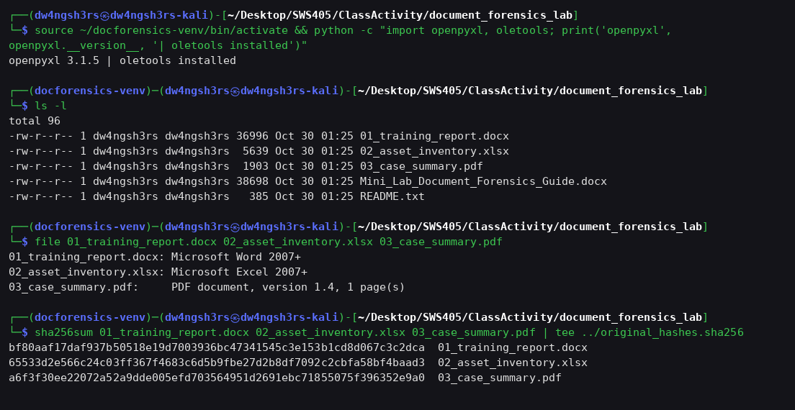
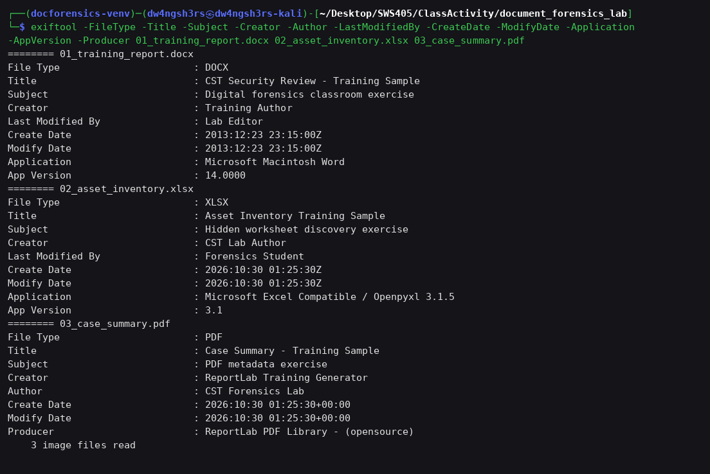
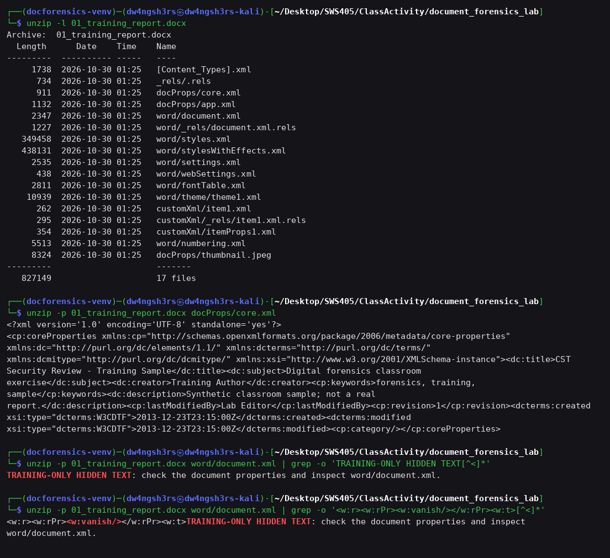
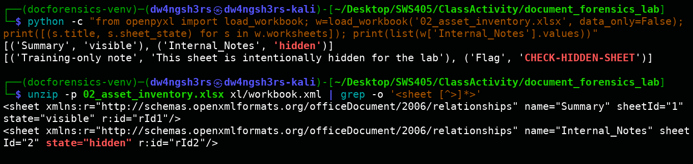
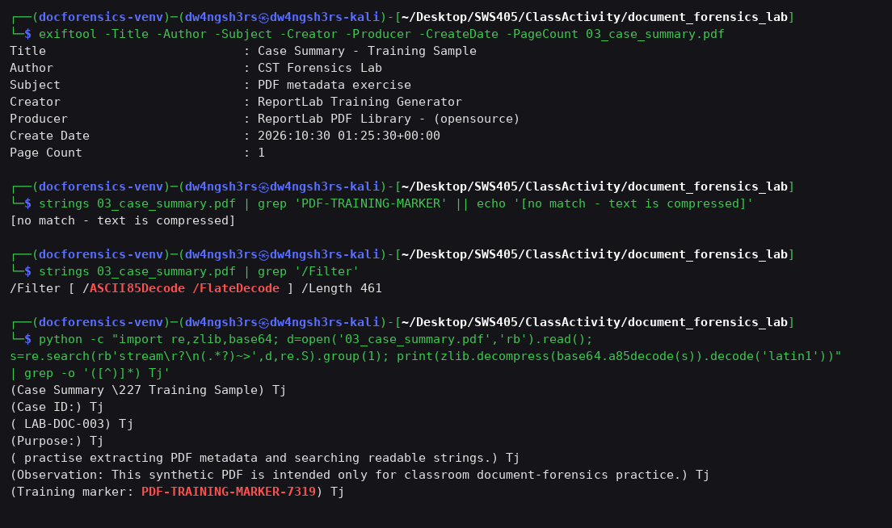
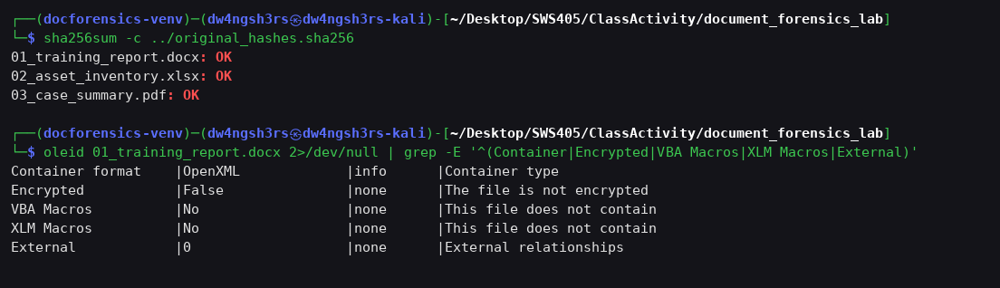

# ClassActivity

# Mini Lab Report: Document File Forensics

| Item | Detail |
|---|---|
| **Module** | SWS405 – Digital-Forensics |
| **Student** | Dechen Wangdra Sherpa (02230281) |

---

## 1. Objective

The aim of this lab was to examine three synthetic training documents (DOCX, XLSX and PDF) the way a forensic examiner would, and to:

1. Identify the real file type of each file and calculate its SHA-256 hash.
2. Extract the document metadata.
3. Inspect the internal (ZIP/XML) structure of a DOCX file and find hidden text.
4. Find a hidden worksheet in an XLSX workbook.
5. Inspect a PDF's metadata and recover a marker hidden in its content.
6. Keep the original samples unchanged throughout and record findings.

---

## 2. Lab Setup (Part A & B)

The tools were checked and installed on Kali Linux. `exiftool`, `file`, `unzip`, `strings` and `sha256sum` were already present. A Python virtual environment was created for `openpyxl` and `oletools`:

```bash
python3 -m venv ~/docforensics-venv
source ~/docforensics-venv/bin/activate
python -m pip install --upgrade pip oletools openpyxl
cd ~/Desktop/SWS405/ClassActivity/document_forensics_lab
ls -l
```

> **Note:** On this Kali install `python3 -m venv` failed because `ensurepip` was missing (the `python3-venv` package needs `sudo` to install). As a workaround the venv was created with `python3 -m venv --without-pip ~/docforensics-venv`, and the packages were installed into it with `python3 -m pip --python ~/docforensics-venv/bin/python install oletools openpyxl`.

---

## 3. Procedure and Evidence

### 3.1 Part C — File type identification and hashing

```bash
file 01_training_report.docx 02_asset_inventory.xlsx 03_case_summary.pdf
sha256sum 01_training_report.docx 02_asset_inventory.xlsx 03_case_summary.pdf | tee ../original_hashes.sha256
```


*Figure 1: Venv check, sample listing, `file` output and original SHA-256 hashes (also saved to `original_hashes.sha256`).*

`file` reads each file's magic bytes rather than trusting its extension. All three extensions match their real content: Word 2007+ (OOXML), Excel 2007+ (OOXML), and PDF 1.4 with 1 page.

### 3.2 Part D — Metadata extraction

```bash
exiftool 01_training_report.docx
exiftool 02_asset_inventory.xlsx
exiftool 03_case_summary.pdf
```


*Figure 2: Key metadata fields extracted by ExifTool from all three samples.*

### 3.3 Part E — DOCX package inspection (hidden text)

```bash
unzip -l 01_training_report.docx
unzip -p 01_training_report.docx docProps/core.xml
unzip -p 01_training_report.docx word/document.xml | grep -o 'TRAINING-ONLY HIDDEN TEXT[^<]*'
```


*Figure 3: The DOCX is a ZIP package of 17 parts. `core.xml` holds the metadata, and `word/document.xml` contains the hidden marker.*

The marker sits in a text run whose run properties include **`<w:vanish/>`**, which is Word's *Hidden* font attribute. Word does not show this text in normal view, but it is still stored in plain form inside the XML.

### 3.4 Part F — Hidden Excel worksheet

```bash
python -c "from openpyxl import load_workbook; w=load_workbook('02_asset_inventory.xlsx', data_only=False); print([(s.title, s.sheet_state) for s in w.worksheets]); print(list(w['Internal_Notes'].values))"
unzip -p 02_asset_inventory.xlsx xl/workbook.xml | grep -o '<sheet [^>]*>'
```


*Figure 4: openpyxl lists the sheet `Internal_Notes` with state `hidden` and the flag `CHECK-HIDDEN-SHEET`. The raw `workbook.xml` confirms `state="hidden"`.*

The workbook was only read, never saved, so the original was not changed (confirmed by the hash check in 3.6).

### 3.5 Part G — PDF inspection

```bash
exiftool 03_case_summary.pdf
strings 03_case_summary.pdf | grep 'PDF-TRAINING-MARKER'
```


*Figure 5: PDF metadata, the failed `strings` search, the stream filters, and the marker recovered by decoding the content stream.*

**Observation:** `strings | grep` found **no match**. The page content stream is encoded with `/Filter [ /ASCII85Decode /FlateDecode ]`, so the visible text is not stored as plain ASCII in the file. This is the limitation the lab guide warns about. To get past it, the stream was decoded in Python (`base64.a85decode` followed by `zlib.decompress`). The decoded text operators (`Tj`) show the marker **`PDF-TRAINING-MARKER-7319`** and the case ID `LAB-DOC-003`.

### 3.6 Integrity verification and macro check

```bash
sha256sum -c ../original_hashes.sha256
oleid 01_training_report.docx
```


*Figure 6: All three originals still match their initial hashes (`OK`). `oleid` reports no encryption, no VBA/XLM macros and no external relationships.*

---

## 4. Findings Summary (Part H)

| | **01_training_report.docx** | **02_asset_inventory.xlsx** | **03_case_summary.pdf** |
|---|---|---|---|
| **SHA-256** | `bf80aaf17daf937b50518e19d7003936bc47341545c3e153b1cd8d067c3c2dca` | `65533d2e566c24c03ff367f4683c6d5b9fbe27d2b8df7092c2cbfa58bf4baad3` | `a6f3f30ee22072a52a9dde005efd703564951d2691ebc71855075f396352e9a0` |
| **File type (`file`)** | Microsoft Word 2007+ | Microsoft Excel 2007+ | PDF document, v1.4, 1 page |
| **Title** | CST Security Review - Training Sample | Asset Inventory Training Sample | Case Summary - Training Sample |
| **Subject** | Digital forensics classroom exercise | Hidden worksheet discovery exercise | PDF metadata exercise |
| **Author / Creator** | Training Author | CST Lab Author | Author: CST Forensics Lab; Creator: ReportLab Training Generator |
| **Last Modified By** | Lab Editor | Forensics Student | — (not present) |
| **Create / Modify Date** | 2013-12-23 23:15:00Z (both) | 2026-10-30 01:25:30Z (both) | 2026-10-30 01:25:30+00:00 (both) |
| **Application / Producer** | Microsoft Macintosh Word 14.0000 | Microsoft Excel Compatible / Openpyxl 3.1.5 | Producer: ReportLab PDF Library - (opensource) |
| **Other** | Keywords, Description, Template Normal.dotm, Revision 1, embedded thumbnail | — | Trapped: False, Page Count 1 |
| **Hidden / internal content** | Hidden-formatted (`<w:vanish/>`) text: *"TRAINING-ONLY HIDDEN TEXT: check the document properties and inspect word/document.xml."* | Worksheet **`Internal_Notes`**, state **hidden**, containing flag **`CHECK-HIDDEN-SHEET`** | Marker **`PDF-TRAINING-MARKER-7319`** inside an ASCII85 + Flate compressed content stream; Case ID LAB-DOC-003 |
| **Tools / commands** | `file`, `sha256sum`, `exiftool`, `unzip -l/-p`, `grep`, `oleid` | `file`, `sha256sum`, `exiftool`, `openpyxl`, `unzip -p` | `file`, `sha256sum`, `exiftool`, `strings`, Python `zlib`/`base64` |
| **Limitations** | Metadata is easy to edit. The 2013 dates come from the template and conflict with the 2026 file-system timestamps. | Read-only inspection. Sheets set to "very hidden" or hidden in other ways would need XML inspection. | `strings` cannot read compressed streams. Other encodings (fonts, images) would need a full PDF parser or viewer. |

### Observations vs. conclusions

- **Observation:** The DOCX internal dates (2013-12-23) are much older than its ZIP entry timestamps and file-system dates (2026-10-30). It also claims to come from *Microsoft Macintosh Word 14*, even though the XLSX in the same set was clearly produced by *openpyxl*.
- **Conclusion (with caution):** The DOCX metadata was most likely inherited from a reused template or set on purpose. It should not be taken as the real creation date. This is an inference and has not been proven.
- **Observation:** None of the three files contained macros, encryption or external links. The hashes did not change during the investigation.

---

## 5. Answers to Lab Questions

**Q1. Which metadata fields were present in each file?**
- **DOCX:** Title, Subject, Creator, Keywords, Description, Last Modified By, Revision Number, Create Date, Modify Date, Template, Total Edit Time, Pages/Words/Characters, Application, App Version, Doc Security and a preview thumbnail. Category, Company and Manager were empty.
- **XLSX:** Title, Subject, Creator, Last Modified By, Create Date, Modify Date, Application and App Version.
- **PDF:** Title, Author, Subject, Creator, Producer, Create Date, Modify Date, Trapped, Page Mode, Page Count and PDF Version. Keywords was empty, and there was no "Last Modified By" field.

**Q2. What training marker was found inside the DOCX package?**
`TRAINING-ONLY HIDDEN TEXT: check the document properties and inspect word/document.xml.` It was found in `word/document.xml`, formatted as hidden text (`<w:vanish/>`).

**Q3. What was the name and state of the hidden worksheet?**
The sheet was **`Internal_Notes`** with state **`hidden`**. It contains the note "This sheet is intentionally hidden for the lab" and the flag **`CHECK-HIDDEN-SHEET`**. The visible sheet is `Summary`.

**Q4. What PDF creator/producer information was visible?**
Creator: **ReportLab Training Generator**. Producer: **ReportLab PDF Library - (opensource)**. Author: **CST Forensics Lab**.

**Q5. Why is metadata alone insufficient to prove who created a file?**
Metadata is self-reported and anyone can edit it. Fields like Author, Creator and Last Modified By come from whatever user name was set in the software, or from a template, and tools such as ExifTool or openpyxl can rewrite them in seconds. This lab shows the problem directly: the DOCX's internal dates (2013) contradict its packaging dates (2026). A hash only proves that a file has or has not changed; it says nothing about who made it. To attribute a file to someone, metadata has to be corroborated with independent evidence such as system logs, email or file-transfer records, device artefacts and chain-of-custody records.

---

## 6. Forensic Practice Followed

- Only the supplied synthetic samples were examined.
- All inspection was **read-only**: `unzip -p` streams to stdout, and openpyxl loads without saving. No file was opened in an editor that could save it.
- SHA-256 hashes were recorded before analysis and checked again afterwards. All three files returned **OK**, so the originals were preserved.
- No macros or embedded content were executed, and `oleid` confirmed none were present.

## 7. Conclusion

The lab was completed successfully. Every file's real type was confirmed and hashed, and its metadata extracted. All three hidden artefacts were found:

- the hidden DOCX text, using `<w:vanish/>` formatting
- the hidden `Internal_Notes` worksheet in the XLSX
- the compressed PDF marker `PDF-TRAINING-MARKER-7319`

The PDF task showed that simple tools like `strings` can miss content that is compressed. The DOCX dates showed why metadata should be treated as a clue and not as proof.
